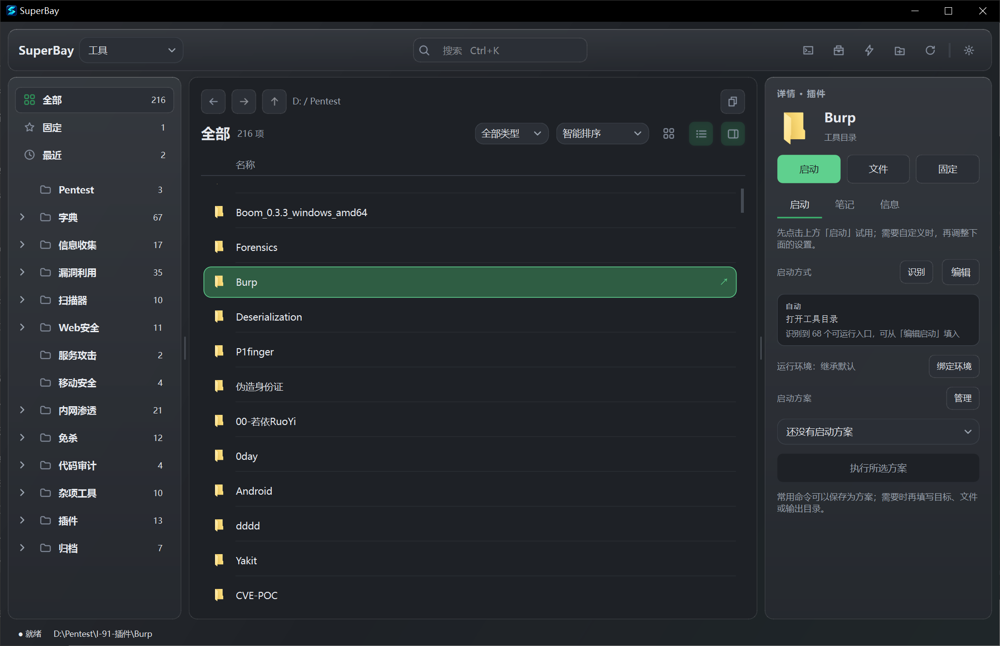

为 AI 时代的创造而来 · WINDOWS 开源工作台

# 项目越来越多。 启动，可以更简单。

AI 让想法变成项目的速度越来越快。下载的工具、生成的代码和不同的运行方式也随之堆积。SuperBay 让它们回到清晰的文件秩序，让每一次开始都不必从寻找入口开始。

[开始使用](user-guide.md){ .md-button .md-button--primary }
[在 GitHub 探索](https://github.com/yanxinwu946/SuperBay){ .md-button }

## 让文件的组织方式，成为工作的起点。

把项目和工具放进熟悉的目录，按自己的方式分类；SuperBay 将它们呈现在一个工作台里。文件在哪里，你就知道它在哪里。

## 少一点整理的负担，多一点创造的余地。

-   **放进目录，就有了位置**

    按自己的习惯归类项目和工具。拖入、移动、重命名，让日益增长的收藏保持清晰。

-   **记得一点，就能找到**

    用名称、标签、笔记或拼音搜索，快速回到想做的事。

-   **配置一次，下次直接出发**

    保存常用启动方式和多套方案，把变化留到运行时填写。

-   **经验留在旁边**

    把说明、心得和踩过的坑写进笔记。项目再次打开时，思路也一起回来。

## 从文件夹，到工作台

1. **选择根目录**：把项目和工具放在你熟悉的位置。
2. **按自己的方式分类**：组织目录，让项目各归其位。
3. **找到它，开始工作**：搜索条目，设置启动方式，留下笔记。

[阅读使用指南 →](user-guide.md)

